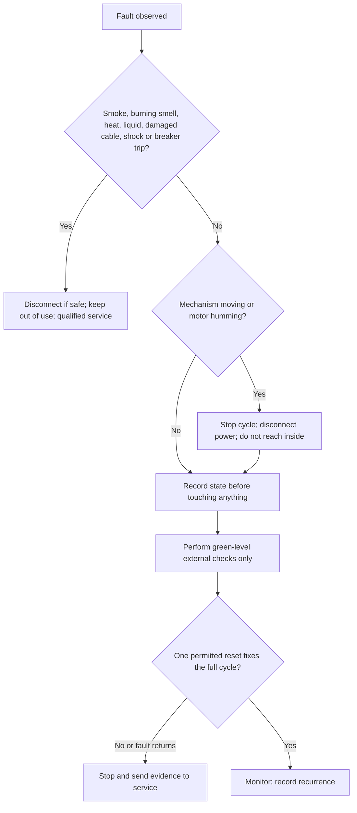
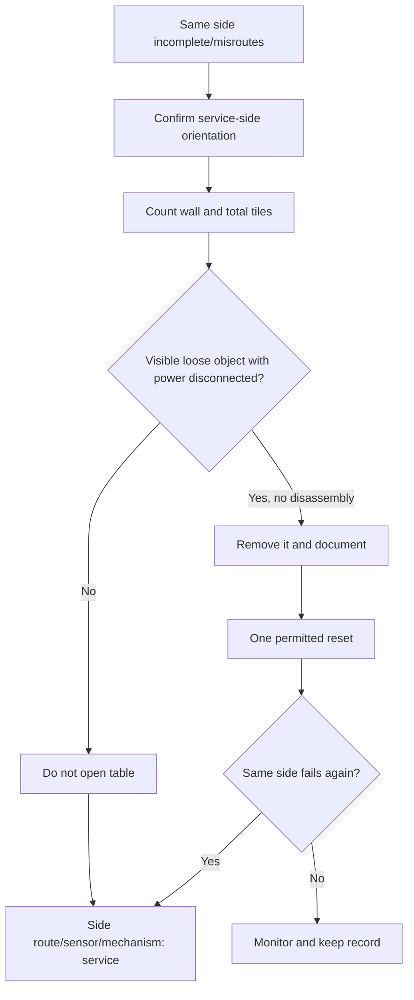

# Automatic Mahjong Table Troubleshooting and Maintenance Manual

> **Language:** English | **Scope:** brand-neutral user and operator checks

This manual helps an owner describe a fault, perform only low-risk external
checks, and decide when qualified service is required. It does not replace the
exact model manual and does not authorize internal electrical or mechanical
work.

## 1. Risk levels

| Level | Meaning | Examples | Action |
|---|---|---|---|
| Green | external, stationary, no tools | mode, approved tiles, table level, visible loose object | user may check after following shutdown procedure |
| Amber | repeated fault or uncertain access | recurring jam, one-side shortage, unusual noise, intermittent panel | stop cycles; collect evidence; contact support |
| Red | electrical, heat, smoke, liquid, moving mechanism | damaged cord, burning smell, breaker trip, exposed wire, liquid ingress | unplug if safe, isolate table, qualified service only |

Never reach into motion, bypass a switch, force a panel, defeat a guard, test
exposed conductors, or spray liquid inside. Do not open covers unless the user
is qualified and the manufacturer has supplied the exact procedure.

## 2. Immediate stop decision



## 3. Evidence first

Record the following before power cycling, because reset may erase useful
information:

| Field | Example |
|---|---|
| Manufacturer/model | exact nameplate wording |
| Serial | share privately with service, not in a public issue |
| Country/power rating | `230 V, 50 Hz` as printed on nameplate |
| Mode and expected wall | selected game and tiles per side |
| Symptom | no power / jam / wrong tile / short wall / noise / shutdown |
| Side/location | service orientation plus flashing indicator |
| Fault display | complete code, punctuation, and flashing pattern |
| Trigger | after move, cleaning, spill, new tiles, power event, or normal use |
| Evidence | nameplate photo, full-cycle video, close photo after power is off |

## 4. Symptom-to-action table

| Symptom | Safe external checks | Likely fault families, not a diagnosis | Stop condition |
|---|---|---|---|
| No power/display | known-good outlet, plug seated, external switch sequence, nameplate voltage | supply, fuse, switch, wiring, power board | damaged cable, heat, trip, still dead |
| Center panel does not rise/lower | remove only loose object on top; confirm level and no overload | obstruction, limit sensing, lift motor/linkage | hum, skew, repeated stop |
| Powers on but will not shuffle | correct mode, panel closed, approved complete tile set | interlock, control state, motor, sensor | one reset fails or code returns |
| Tiles jam | power off; remove only plainly reachable loose tile/debris | wrong/deformed tile, guide, belt, roller, sensor | access requires cover/tool; jam repeats |
| Wrong sorting | isolate mixed, wet, dirty, chipped, or wrong-spec tiles | magnetic mismatch, sorter/sensor/route | correct tiles still misroute |
| One side short | count delivered tiles; record side; check level | side conveyor, bridge, sensor, route obstruction | repeats on same side |
| All sides short/wrong | verify selected mode and total approved set | mode/configuration, missing tiles, central handling | count correct but cycle wrong |
| Noise/vibration | stop; remove external loose objects; verify stable floor | foreign object, belt, bearing, gear, motor | grinding, increasing noise, heat |
| Stops after warming | verify ventilation and rating; allow safe cool-down | overload, thermal protection, power/control fault | repeats or casing abnormal hot |
| Code appears | photograph code and flashing position; use model manual | code meaning is model-specific | code returns after one permitted reset |

## 5. Quantitative checks

### Tile reconciliation

Use the model/mode manual for the expected tile count.

```text
accounted_tiles = delivered_tiles
                + visible_discarded_or_reserved_tiles
                + safely_removed_loose_tiles

unaccounted_tiles = expected_mode_tiles - accounted_tiles
```

Do not infer an internal jam from a negative or positive result until mixed tile
sets, spare tiles, Flowers/Jokers, and the selected mode have been checked.

For equal walls:

```text
expected_tiles_per_side = wall_tiles_total / number_of_sides
side_shortage = expected_tiles_per_side - actual_tiles_on_that_side
```

### Recurrence record

Do not repeatedly cycle a faulty table merely to produce statistics. For
ordinary use before the stop decision:

```text
observed_recurrence_rate = recorded_fault_cycles / recorded_total_cycles
```

One repeated jam after a permitted reset is enough to stop; a low percentage
does not make a red-level event safe.

### Supply comparison

Only a competent person using an approved outlet tester should measure supply;
never probe inside the table.

```text
voltage_deviation_percent
  = abs(measured_outlet_voltage - nameplate_nominal_voltage)
    / nameplate_nominal_voltage x 100
```

Acceptable range comes from the model manual and local electrical standard, not
from a generic percentage in this guide.

## 6. Diagnostic branches

### Same side fails repeatedly



### Tiles are rejected or mis-sorted

1. Compare every tile with the approved set: dimensions, thickness, weight,
   surface, magnet configuration, and markings.
2. Remove mixed, chipped, swollen, sticky, wet, or deformed tiles.
3. Count the complete set for the selected mode.
4. Clean only as the tile/table manufacturer permits and dry fully.
5. If known-correct tiles fail on the same route, stop and report the route.

## 7. Cleaning and preventive maintenance

| Interval | User-level action | Do not do |
|---|---|---|
| After use | remove external foreign objects; dry soft wipe; keep drinks away | spray cleaner into openings |
| Weekly/high use | inspect tiles, cloth, cable, plug, ventilation, table stability | use damaged tiles or tape near paths |
| Manufacturer interval | perform only named user procedures | invent a lubrication schedule |
| After move/spill/power event | inspect externally and follow model recommissioning steps | immediately cycle a wet or damaged table |

If a manual specifies both time and operating cycles, use the earlier due point:

```text
next_maintenance = earlier_of(calendar_due_date, cycle_count_due)
```

Apply cleaner to a cloth, not directly to the table. Do not use abrasive,
solvent, oil, grease, or adhesive unless the exact manual names the product and
location. Wrong lubricant can contaminate sensors, belts, rollers, and tiles.

## 8. Service handoff template

```text
Model:
Serial (private message only):
Country and nameplate power:
Selected mode:
Approved tile set / total count:
Exact symptom:
Side or position indicator:
Complete fault code:
First occurrence and trigger:
External checks completed:
Result of the one permitted reset:
Photos/video attached:
```

## 9. Model-specific information

A generic guide must never decode a model's fault code by analogy. Use the
manufacturer's exact manual. INEAN PLAY owners can use the
[official support repository](https://github.com/ineanplay/automatic-okey-table-support)
and its [fault-code reference](https://github.com/ineanplay/automatic-okey-table-support/blob/main/docs/fault-codes.md).
Other brands should use their own service documentation.

## Sources

- [Bespoke Mahjong: troubleshooting](https://www.bespokemahjong.com/pages/troubleshooting)
- [INEAN PLAY automatic table support](https://github.com/ineanplay/automatic-okey-table-support)
- [INEAN PLAY safety information](https://github.com/ineanplay/automatic-okey-table-support/blob/main/docs/safety.md)

## Contact

- [ineanplay.com](https://ineanplay.com/)
- [WhatsApp: +86 173 7839 0199](https://wa.me/8617378390199)
- [service@ineanplay.com](mailto:service@ineanplay.com)
