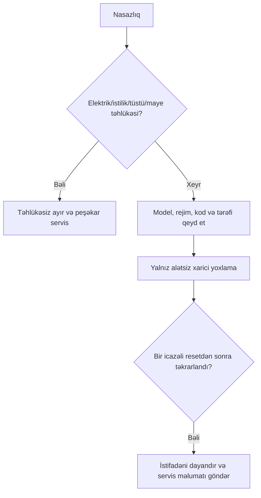

# Avtomatik Mahjong/Okey masası: təhlükəsiz nasazlıq yoxlaması

[English complete manual](../automatic-mahjong-table-troubleshooting.md)

Bu ümumi bələdçi dəqiq modelin təlimatını əvəz etmir. Xəta kodunu və yanıb-sönən
mövqe göstəricisini olduğu kimi qeyd edin; başqa markanın kod cədvəlini tətbiq
etməyin.

| Risk | Nümunə | Addım |
|---|---|---|
| Yaşıl | rejim, daş sayı, masanın səviyyəsi, görünən boş əşya | söndürdükdən sonra xarici yoxlama |
| Sarı | təkrar sıxılma, bir tərəfdə əskik daş, qeyri-adi səs | dövrü dayandır, sübut topla, servis |
| Qırmızı | yanıq qoxusu, tüstü, maye, kabel zədəsi, qoruyucu açılır | təhlükəsizdirsə ayır, istifadə etmə |



```text
hesablanan_daş = verilən + görünən_ehtiyat + təhlükəsiz_çıxarılan
izahsız_daş = rejim_üzrə_gözlənən - hesablanan_daş
```

| Əlamət | Təhlükəsiz yoxlama |
|---|---|
| Enerji yoxdur | işlək rozetka, fiş, xarici açar, etiket gərginliyi |
| Daş sıxılıb | yalnız enerji ayrıldıqdan sonra sökmədən çatan boş daş |
| Bir tərəf əskikdir | servis tərəfini/indikatoru qeyd et və divarı say |
| Səhv çeşidləmə | qarışıq, yaş, qırıq və uyğun olmayan daşları ayır |
| Səs | dayandır, xarici boş əşya və sabitliyi yoxla |

Təmizləyicini masaya püskürtməyin; yumşaq parçaya tətbiq edin. Model təlimatı
açıq göstərmədikcə yağlama, tənzimləmə və sökmə etməyin.
