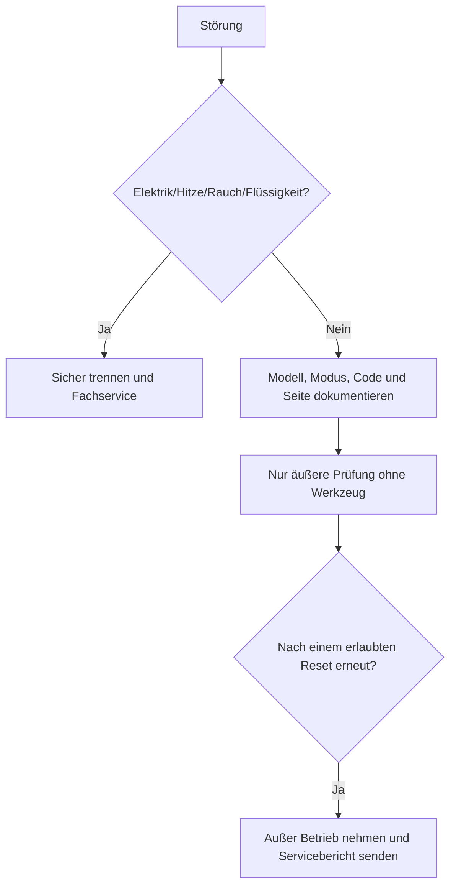

# Automatischer Mahjong-/Okey-Tisch: sichere Fehlersuche

[Anleitung zur Alltagspflege](../../community/de.md)

Diese markenneutrale Anleitung ersetzt nicht das Handbuch des genauen Modells.
Fehlercode und blinkende Positionsanzeige unverändert notieren; Codes anderer
Hersteller dürfen nicht übertragen oder übersetzt werden.

| Risiko | Beispiele | Maßnahme |
|---|---|---|
| Grün | Modus, Steinzählung, Tisch waagerecht, äußerer loser Gegenstand | nach Abschaltung äußerlich prüfen |
| Gelb | wiederholter Stau, eine Seite unvollständig, ungewöhnliches Geräusch | Zyklen stoppen, Belege sammeln, Service |
| Rot | Brandgeruch, Rauch, Flüssigkeit, Kabelschaden, Sicherung löst aus | wenn sicher Netz trennen, sperren, Fachservice |



```text
erfasste_Steine = ausgegebene + sichtbar_reservierte + sicher_entnommene
nicht_erfasste_Steine = Sollzahl_des_Modus - erfasste_Steine
```

| Symptom | Sichere Prüfung |
|---|---|
| Keine Spannung/Anzeige | bekannte Steckdose, Stecker, äußerer Schalter, Typenschild |
| Stau | nur spannungslos und ohne Demontage erreichbaren losen Stein entfernen |
| Eine Seite zu kurz | Serviceseite/Anzeige notieren und Wand zählen |
| Falsche Sortierung | gemischte, nasse, beschädigte oder falsche Steine aussortieren |
| Geräusch | stoppen, äußere lose Teile und Standfestigkeit prüfen |

Reiniger auf ein Tuch geben, nicht in Öffnungen sprühen. Ohne ausdrückliche
Modellanweisung nicht schmieren, einstellen oder Abdeckungen öffnen.
