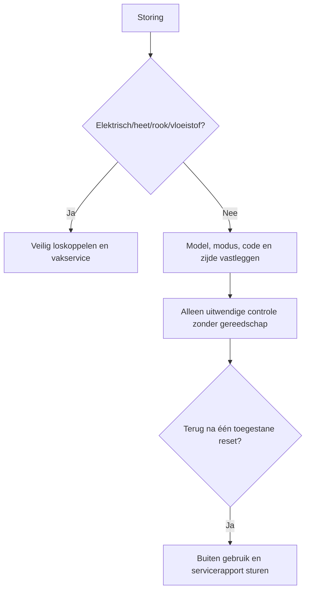

# Automatische Mahjong-/Okeytafel: veilige probleemdiagnose

[English complete manual](../automatic-mahjong-table-troubleshooting.md)

Deze merkonafhankelijke gids vervangt nooit de handleiding van het exacte
model. Noteer een foutcode en knipperende positie letterlijk; vertaal een code
niet met de tabel van een ander merk.

| Risico | Voorbeelden | Actie |
|---|---|---|
| Groen | modus, steentelling, tafel waterpas, zichtbaar los voorwerp | na uitschakelen alleen extern controleren |
| Oranje | herhaalde blokkering, één zijde tekort, vreemd geluid | cycli stoppen, bewijs vastleggen, service |
| Rood | brandlucht, rook, vloeistof, kabelschade, automaat valt uit | indien veilig stekker eruit, niet gebruiken |



```text
getelde_stenen = geleverde + zichtbaar_gereserveerde + veilig_verwijderde
onverklaarde_stenen = verwachte_modus_totaal - getelde_stenen
```

| Symptoom | Veilige controle |
|---|---|
| Geen stroom | bekend werkend stopcontact, stekker, schakelaar, typeplaatje |
| Blokkering | alleen spanningsloos en zonder demontage bereikbare losse steen |
| Eén zijde tekort | servicezijde/indicator noteren en muur tellen |
| Verkeerd sorteren | gemengde, natte, beschadigde of ongeschikte stenen apart |
| Geluid | stoppen, externe losse delen en stabiliteit controleren |

Breng reiniger op een doek aan, nooit rechtstreeks in openingen. Niet smeren,
afstellen of openen zonder een modelspecifieke instructie.

INEAN PLAY: [ineanplay.com](https://ineanplay.com/) · [WhatsApp](https://wa.me/8617378390199) · [service](mailto:service@ineanplay.com)

