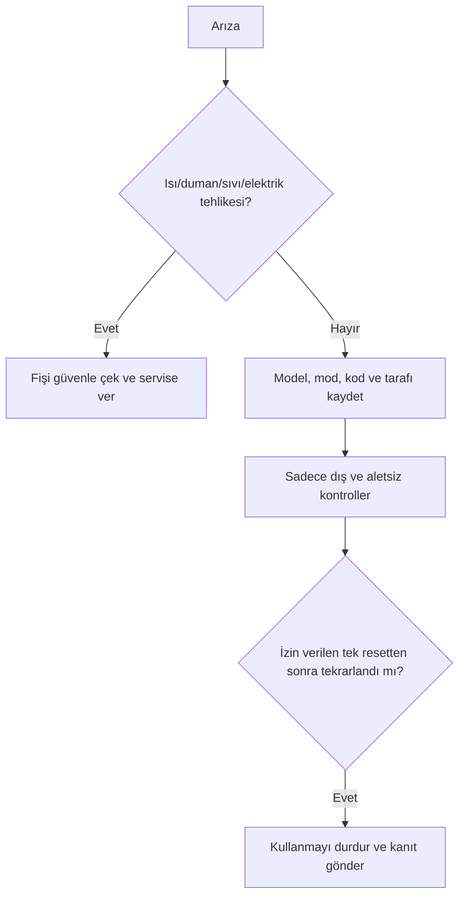

# Otomatik Okey/Mahjong masası: güvenli arıza tespiti

[English complete manual](../automatic-mahjong-table-troubleshooting.md)

Bu genel kılavuz, belirli modelin kullanım ve servis kılavuzunun yerine geçmez.
Ekrandaki hata kodunu aynen kaydedin; başka markanın kod tablosuyla çevirmeyin.

| Risk | Örnek | İşlem |
|---|---|---|
| Yeşil | mod, taş sayısı, masa seviyesi, dışarıdan görünen gevşek cisim | kapatma prosedüründen sonra dış kontrol |
| Sarı | aynı tarafta eksik taş, tekrarlayan sıkışma, anormal ses | çevrimi durdur, kanıt topla, servis |
| Kırmızı | yanık kokusu, duman, sıvı, hasarlı kablo, sigorta atması | güvenliyse fişi çek, kullanma, uzman servis |



## Taş hesabı

```text
hesaplanan_taş = teslim_edilen + güvenle_görülen + güvenle_çıkarılan
eksik_taş = moda_göre_beklenen - hesaplanan_taş
```

| Belirti | Güvenli kontrol |
|---|---|
| Güç yok | çalışan priz, fiş, dış anahtar, etiket gerilimi |
| Taş sıkışması | güç kesikken yalnız sökmeden erişilen gevşek taşı çıkar |
| Tek taraf eksik | tarafı ve yanıp sönen göstergeyi kaydet, taşları say |
| Yanlış ayırma | karışık, ıslak, kırık veya uyumsuz taşları ayır |
| Gürültü | durdur, dış gevşek cisim ve masa dengesini kontrol et |

`gösterge` burada Okey oyunundaki gösterge taşı değil, makinenin yanıp sönen
**konum göstergesi** anlamındadır. Terimin bağlamı özellikle ayrılmıştır.

Temizlik maddesini masaya püskürtmeyin; yumuşak beze uygulayın. Model kılavuzu
ürün ve noktayı açıkça belirtmedikçe yağlama yapmayın.

INEAN PLAY: [ineanplay.com](https://ineanplay.com/) · [WhatsApp](https://wa.me/8617378390199) · [service](mailto:service@ineanplay.com)

