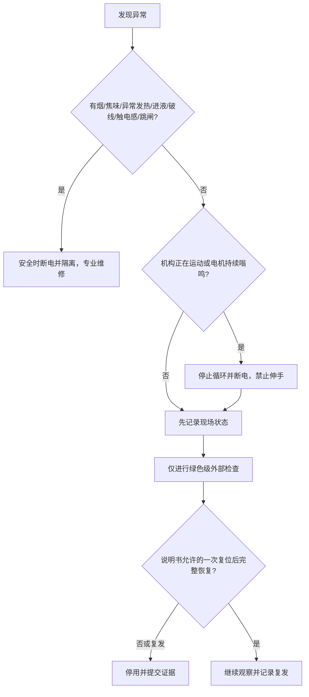
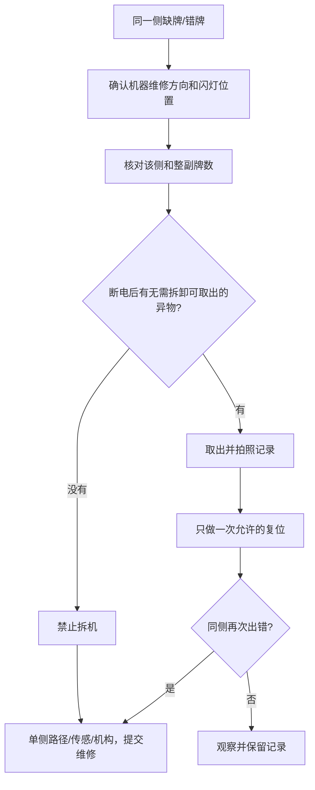

# 自动麻将机常见故障诊断与维保手册

[English version](../automatic-mahjong-table-troubleshooting.md)

本手册适用于不同品牌自动麻将机的外部安全检查和报修准备，不代替具体型号
说明书。故障码含义必须使用该型号的正式资料，不能按其他品牌代码猜测。

## 1. 风险分级

| 等级 | 范围 | 示例 | 应对 |
|---|---|---|---|
| 绿色 | 断电后的外部无工具检查 | 模式、牌数、桌面水平、可直接取出的异物 | 用户可按说明书检查 |
| 黄色 | 重复或位置不明的故障 | 单侧缺牌、反复卡牌、异常声音、升降间歇失效 | 停止循环，记录证据并报修 |
| 红色 | 电气、热、烟、进液或运动机构危险 | 破损电源线、焦味、跳闸、裸线、进液 | 安全时断电隔离，只能专业维修 |

禁止把手伸入运动机构、短接安全开关、强推升降板、检测裸露线路或向机器
内部喷清洁剂。没有厂家针对该型号的步骤和资质时，不应拆盖板。

## 2. 先判断是否必须立即停机



## 3. 症状检查表

| 症状 | 可安全检查 | 可能的故障族，不是远程结论 | 停止条件 |
|---|---|---|---|
| 不通电/无显示 | 已知正常的插座、插头、外部开关顺序、铭牌电压 | 供电、保险、开关、线束、电源板 | 线缆损坏、发热、跳闸或仍无电 |
| 中心升降不动 | 断电后取走桌面可见物，确认桌子水平且无压物 | 异物、限位、升降电机或连杆 | 嗡鸣、倾斜、反复停止 |
| 通电但不洗牌 | 模式正确、面板闭合、使用完整适配牌 | 联锁、控制状态、电机、传感器 | 一次复位无效或报码复发 |
| 卡牌 | 断电后仅取出无需拆卸即可触及的散牌/异物 | 牌不适配、导轨、皮带、滚轮、传感器 | 需要工具/拆盖或再次卡住 |
| 识别/分拣错误 | 隔离混牌、湿牌、破损牌、变形牌 | 磁性/尺寸不符、分拣器、传感器 | 正确牌仍在同一路径出错 |
| 单侧少牌 | 数该侧牌墙，记录维修方向，检查水平 | 单侧输送、桥、传感器、路径异物 | 同侧复发 |
| 所有方向数量错 | 模式、整副牌总数、特殊牌配置 | 模式/配置、缺牌、中央处理 | 总数正确但循环仍错 |
| 异响/振动 | 停机，移走外部松动物，检查地面稳定 | 异物、皮带、轴承、齿轮、电机 | 摩擦/敲击加剧或发热 |
| 热机后停机 | 通风、铭牌要求、冷却 | 过载、热保护、电源或控制 | 复发、外壳异常热或跳闸 |

## 4. 牌张核对公式

先从型号和当前模式说明书取得“应有牌数”。

```text
已核对牌数 = 已送出牌 + 桌面/保留区可见牌 + 断电后安全取出的散牌
未核对牌数 = 当前模式应有牌数 - 已核对牌数
```

对于四边等长牌墙：

```text
每边应有牌数 = 牌墙总牌数 / 边数
某边缺牌数 = 每边应有牌数 - 该边实际牌数
```

计算异常不等于已经证明内部卡牌；还要排除混入备用牌、花牌/百搭牌配置、
模式选择错误和两副牌混用。

## 5. 单侧重复故障定位



## 6. 供电偏差记录

只能由有能力的人员使用合规插座测试仪在墙上插座测量，禁止探测机器内部：

```text
电压偏差百分比
= |插座实测电压 - 铭牌额定电压| / 铭牌额定电压 x 100%
```

允许范围必须来自具体型号说明书和当地电气标准，本通用手册不虚构一个全球
通用百分比。

## 7. 清洁与周期维保

| 时间 | 用户可做 | 禁止 |
|---|---|---|
| 每次使用后 | 清除桌面异物，干燥软布擦拭，饮料远离桌面 | 向缝隙喷清洁剂 |
| 每周/高频使用 | 检查牌、桌布、电缆、插头、通风和桌体稳定 | 继续使用破损/粘污牌 |
| 厂家规定周期 | 只做说明书明确列出的用户项目 | 自行制定加油润滑计划 |
| 搬运/泼洒/电源事件后 | 外观检查并按型号重新启用 | 设备潮湿或受损时反复试机 |

若厂家同时规定日期和循环次数，应取先到者：

```text
下次维保时间 = min(日历到期时间, 循环次数到期时间)
```

## 8. 报修信息模板

```text
品牌和准确型号：
序列号（只私发客服）：
国家和铭牌电源：
当前模式：
适配牌型号与总数：
准确症状：
故障侧/闪灯位置：
完整故障码：
首次出现时间及诱因：
已完成的外部检查：
一次允许复位的结果：
照片/视频：
```

来源：[Bespoke Mahjong troubleshooting](https://www.bespokemahjong.com/pages/troubleshooting)、
[INEAN PLAY support](https://github.com/ineanplay/automatic-okey-table-support)。

INEAN PLAY：[ineanplay.com](https://ineanplay.com/) ·
[WhatsApp](https://wa.me/8617378390199) ·
[service@ineanplay.com](mailto:service@ineanplay.com)
